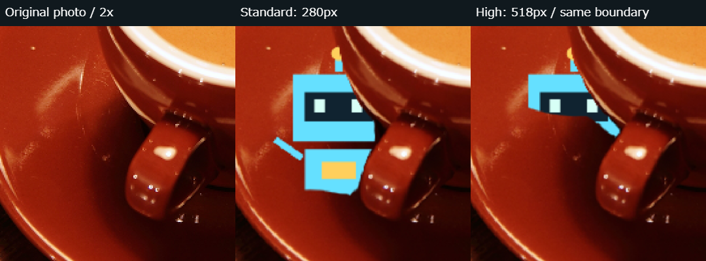

# v0.8.2 — HIGH DETAIL DEPTH LAB

## 調査結果

v0.8.1では元写真の読込時に長辺1024pxへ縮小し、そのCanvasを推論用・描画用に共用していました。DepthModeはその画像をさらに長辺280pxへ縮小、各軸を14の倍数へ丸め、推論結果を解析用写真の寸法へ拡大して返していました。したがって1024pxより大きい元写真の細部は表示前に失われていました。既存518px設定も実入力を増やすものですが、詳細設定の中にありました。

ロボットは固定256×256のCanvas素材を拡縮し、最終CanvasはDPRを2までに制限していました。マスクは生深度を閾値で二値化しており、表示バッファの解像度とモデルの境界誤差の両方に影響されます。

## 必要箇所の変更

- 解析用写真は従来の長辺1024px上限を維持。標準のモデル入力は長辺280pxで、前処理・重みは変更しません。
- 表示用写真を元画像から別に生成。読込時の表示領域の幅・画面高70%・DPR（上限3）から必要な大きさを算出し、元画像の画素数、長辺2048px、約3,000,000画素で制限します。常に元写真と同寸のCanvasにはしません。元画像を表示バッファ以上に拡大して保持しません。画像デコード自体のメモリはブラウザ依存です。
- 解析前、失敗後もこの表示用写真を表示。解析後のDepthPanelへも解析用縮小Canvasを渡さず、表示用Canvasを渡します。
- 推論の生出力を有効期間内にコピー・転送して、描画用の座標へ直接bilinear復元。解析用1024pxを経由した二段階のマップ拡大を避けます。表示用マップの拡大は高解像度推論とは呼びません。推論テンソルは既存のfinallyでdisposeし、不要なコピーを保持しません。
- 写真、ロボット、マスク、可視性／タップ判定を同じ描画用画像の座標で扱い、既存の正規化位置・contain・前面反転・比較表示変換を維持します。
- ロボットは同じ元のCanvas描画を256〜1024pxで再描画。固定256px画像を大きくする方式を避けます。見かけの位置・大きさ（短辺の35%）は維持します。
- 最終描画Canvasは奥行きモードのみDPR上限3、長辺2048px・約3MPの制限。CSS上の写真サイズは変更しません。他モードのDPR設定は維持します。
- 遮蔽の閾値付近に約1描画画素分のalpha被覆率を導入。近傍深度勾配で幅を制限し、相対深度幅の上限は0.004。平坦部分を広くぼかさず、完全に隠れた画素は透明のままです。可視部分のタップ判定は既存通りalpha128以上、半透明の薄い縁だけを正解にしません。

表示用写真は読込時の画面寸法で作成します。回転やウィンドウ拡大時に原寸画像を保持して自動再展開する構成は採用していません。座標整合は維持しますが、広い画面へ変えた後の鮮明さにはこの上限が影響します。最悪時は写真・合成・レイヤー各約12MBに加え、深度Float32・可視マスク・推論用画像・WASMヒープが必要で、総メモリは12MBではありません。

## 標準／高精細

「奥行きを解析」の近くに標準／高精細を配置。初期値280、高精細518はどちらも**長辺**です。各軸を14の倍数に丸めるので、正方形固定ではありません。従来の詳細392px選択は2択のUIへ整理しました。

選択だけでは推論・モデル再読込をしません。前回の解析結果を表示しつつ「未適用」と案内します。解析を押した時に次の入力サイズを設定し、同じDepthMode・Worker・モデルセッションを再利用します。解析中は画質選択と連打を防止。失敗しても元写真・表示用写真は残り、標準で再試行できます。画像差替え／モード切替による既存の世代管理を維持します。解析結果は4実験で共用し、ドラッグ・奥行き変更・隠し直しで推論しません。

モデルは既存Depth Anything V2 Small Q4 ONNX、revision `4472b7362082ad9968fee890ca0f1e5aca36b93d`、27,404,416 bytes、Apache-2.0のままです。ONNX Runtime Web 1.23.2／MIT、Worker／単一スレッドWASMも維持。新しいモデル・認識ライブラリ・有料API・送信・保存機能は追加しません。

## 同じ実写真の比較

左が元写真、中央が標準、右が高精細。同梱のCC0 coffee.png（Rachel Michetti、600×400）を使用。表示倍率、ロボット中心(0.30,0.60)、大きさ140×140元写真pxは同じです。カップ取っ手の同じ境界点(0.34,0.60)の生深度を基準に合わせ、標準の奥行き33、高精細46に調整しました。表示値を同じにした比較ではありません。切り出しは元写真の(100,160)から180×180、2倍の360×360で並べています。

**全面的な改善は確認できません。**カップの輪郭に接する部分の一部は高精細の方が細かくなっていますが、ロボット下部に皿側から斜めの誤った遮蔽が入り、標準より悪化しています。標準にも胴体下側の不要な欠けが残ります。細かいギザギザを隠すために画像をぼかして改善と扱うことはせず、そのまま比較PNGに残しています。正解深度の測定ではなく、この写真に対する目視比較です。

| 寸法・時間 | 標準 | 高精細 |
| --- | --- | --- |
| 元写真 | 600×400 | 同じ |
| 解析用写真 | 600×400 | 同じ |
| 実モデル入力 | 280×182 | 518×350 |
| 生深度出力 | 280×182 | 518×350 |
| 写真・ロボット合成・遮蔽バッファ | 600×400 | 同じ |
| ロボット素材 | 256×256 | 同じ（この写真では十分） |
| 最終Canvas / CSS | 1092×1236 / 364×412 | 同じ |
| 今回解析（前処理・復元込み） | 1652.7ms | 6368.1ms |
| 初回モデル読込・初期化 | 3148.6ms | 再読込なし、同一セッション |

Windows Chrome157、DPR3のPC実測。単発試行で、同時に別の関連確認も実行したため比較ベンチマークではありません。別試行でも標準約1.4秒、高精細約3.9秒と変動しました。初期化時間と各解析時間を混ぜず、`depth-validation/v0.8.2-detail.json`にUA・時刻・寸法・設定を記録しています。iPhoneの値ではありません。

写真表示の画素数差は、小さい600×400サンプルでは元写真上限のため増えません。模擬入力の3000×4000縦画像では、解析用768×1024とは別にDPR3の表示用1092×1456を作成することをPCで確認。これは画素管理のテストであり、その模擬画像で実モデルの品質を確認したものではありません。

## 検証・未確認

関連ユニット12件成功：表示上限・DPR・非拡大、境界alpha・OFF、縦横／鏡像／比較座標、既存の深度・かくれんぼ判定。Chromeの関連ブラウザ5件成功：実Q4両解像度／同一モデル読込1回／連打防止／標準復帰／4実験で共用、模擬高精細失敗から写真保持・標準復帰、既存遮蔽ON/OFFと2点比較、写真差替え・モード切替中の遅着破棄、かくれんぼ一連のプレイ・可視タップ・隠し直し時の推論なし。模擬テストは本番の実推論と区別します。

`npm run build`成功、固定48資産と配布サンプルを照合してdistへ配置。親メニューのVersion表記を0.8.2へ更新し、専用の`npm run test:menu -- --hide-only`で既存メニューから実Q4推論まで確認。通常の全件回帰試験は行いません。既存TensorFlow.jsの大きいchunk警告は残ります。

iPhone Safari実機の性能・メモリ・指操作・実カメラ反転・EXIF／HEICは未確認。コップ・箱・壁の実写真と前後交換ペアは手元になく、今回も未確認です。同梱写真の成功／悪化例や模擬データで代替したとは報告しません。手順は[IPHONE_CHECKLIST.md](IPHONE_CHECKLIST.md)。commit・push・公開は行いません。
