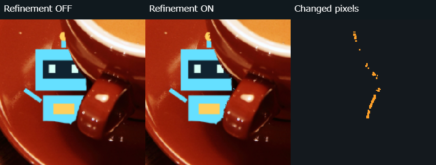
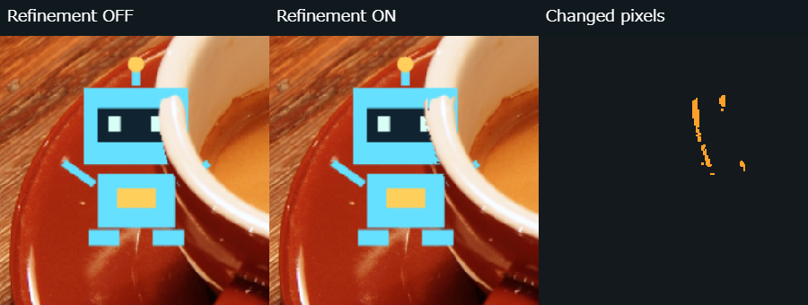
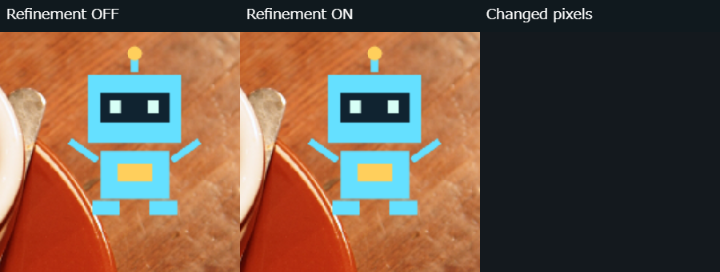
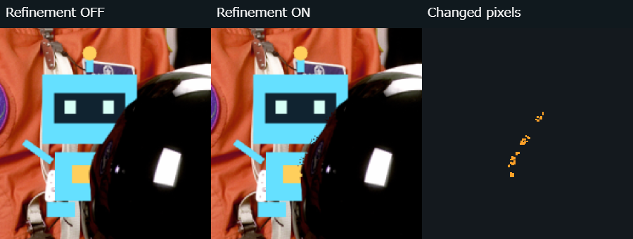
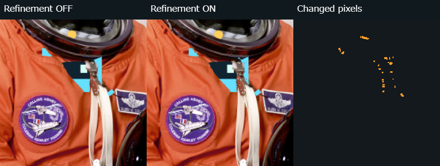

# v0.8.3 — EDGE REFINEMENT / 輪郭補正

## 既存処理と変更範囲

v0.8.2の`occlusionAlpha`は生深度とロボットの奥行きを比較し、深度勾配を用いる約1描画画素分のalpha被覆率でギザギザを軽減しています。この処理、モデル・前処理・解析解像度、写真の表示バッファ、正規化座標／contain／前面反転は変更しません。新しい補正は、この従来マスクを入力にする別段階です。OFFではそのまま返します。

自由配置と、かくれんぼの「隠す」に輪郭補正ON／OFFを追加。初期値OFF、設定はこのタブ内のみです。従来の隠れ処理ON／OFFとは別で、隠れ処理OFFでは補正も適用しません。元の深度配列を変更せず、色分け・2点比較に影響しません。

## 補正の仕様

1. 初回ON時に表示用写真の輝度と横・縦勾配を計算してキャッシュします。RGBの差も候補評価に使います。同じ写真では、切替・ドラッグ・奥行き変更・解析画質変更で輪郭情報を作り直しません。写真ID・寸法の変更、写真破棄・停止・モード切替で破棄します。
2. ロボット本体に重なる画素のうち、深度の閾値を局所的に横断する境界だけを調べます。深度勾配がない、または閾値を横断しない場所では補正しません。写真の柄だけで新しい遮蔽を作りません。
3. 深度勾配の法線方向へ写真輪郭を探します。移動上限は`min(6,max(2,round(短辺/150)))`描画画素。600×400と512×512の検証写真では3pxです。深度境界帯と最大約1画素の被覆率以外は従来マスクを保持します。
4. 輝度勾配24以上、深度法線との方向一致0.85以上、両側のRGB距離48以上を必要とします。両側それぞれの2→3px先の色差は24以下、接線方向±2pxでも強度・方向の連続性を要求します。文字や木目への反応を減らすための保守的な初期値で、物体・影・文字を意味的に識別するものではありません。
5. 最良候補から2pxより離れ、スコアが80%以上の候補が競合すれば従来マスクを維持。競合確認のため移動上限の外側2pxも参照しますが、移動量は上限を超えません。有力候補がない場合や移動量0.5px未満、奥行きスライダー両端でも従来マスクを維持します。
6. 採用時だけ境界を法線方向に移し、既存と同じ深度勾配由来の被覆幅でalphaを生成。広いぼかしや深度の書換えは行いません。サンプル専用の座標・色・例外分岐はありません。

写真全体の輝度・勾配計算は初回のみ。操作時はキャッシュを参照し、ロボットが重なる深度境界帯の候補だけを評価します。alpha配列の走査やCanvasの合成は既存同様に必要です。キャッシュは最大約3MPのRGBAとInt16勾配2枚で約24MB、作成中は一時輝度配列も使います。これは構造から算出したバッファ容量であり、端末全体の実測メモリ値ではありません。

## かくれんぼとの整合

開始可否は補正後に実際に描く可視マスクから求めます。開始時に設定と可視マスクを固定し、探索・発見演出ではそのマスクを再利用。描画とタップは同じalpha128以上の本体画素を参照し、既存の7 CSS pxのタップ許容を維持します。探索中は補正スイッチ・可視率・診断を表示しません。隠し直しでAIは再実行せず、編集へ戻った時だけ必要なマスクを更新します。解析中にはゲームを開始できません。

## 標準解析による実写真比較

以下は同じ写真・同じ標準解析結果・同じ倍率・同じ位置／大きさ／奥行きのOFF／ON比較です。左OFF、中央ON、右が変更画素（橙）。差分は効果箇所を示すだけで、正解や改善率ではありません。

### カップ取っ手・皿：一部の隠れすぎ軽減

ロボット中心(0.30,0.60)、奥行き33。取っ手の横で本体の欠けが局所的に減る部分があります。ただし正解マスクはなく、全体の精度向上を示すものではありません。87描画画素が変化、最大移動2.98px。皿側の大きな前後関係は変えません。

### カップの明確な縁：悪化例

中心(0.27,0.36)、同一奥行き17。縁の局所補正で109pxが変化しましたが、顔の縁に細かい欠けが増えています。写真の強い輪郭があっても、深度法線・写真輪郭・画素ごとの候補が一致せず、悪化する場合があります。これを改善として報告しません。OFFへ即座に戻せます。

### 木目：変化なし

中心(0.82,0.25)、奥行き0（ロボットが写真より手前）。木目や影があっても、対象となる深度の遮蔽境界がないため変更0px。写真の線だけでロボットを隠していません。「輪郭があれば必ず補正する」処理ではありません。

### 明確なヘルメット輪郭：変化小

中心(0.56,0.80)、奥行き35。46pxが変化しますが、目視での改善は限定的です。局所的な段差も残り、明確な輪郭でも常に良くなるとは言えません。

### 文字・縫い目・影を含む写真

中心(0.42,0.65)、奥行き51。縫い目・反射・影付近で80pxの局所変化。広い誤遮蔽は直らず、局所的な欠けも残ります。文字／影を意味的に判別しているわけではなく、誤補正ゼロとは報告しません。強度・連続性・競合・移動上限による制限と、OFFでの比較が必要です。

### 前回の皿の誤遮蔽の扱い

[v0.8.2の標準／高精細比較](depth-validation/v0.8.2-boundary.png)で、高精細時に皿上のロボット下部が広く斜めに消える例がありました。写真の物体輪郭に対応しない領域が数十画素に及ぶため、局所的な縁のずれより広い深度誤りと判断します。今回の3px補正では胴体全体を回復できず、対象外です。写真の輪郭から新しい遮蔽物や大きな前後関係を作って修正する例外処理は入れていません。今回の実写真比較はまず標準280pxで行い、モデル・標準／高精細の設定は維持しています。

## PCの実測時間

Windows Chrome157、DPR3。600×400のcoffee.pngと512×512のastronaut.pngを実Q4モデルで標準解析。秒／ミリ秒はいずれも実測で、iPhoneの値ではありません。

| 処理 | コーヒー写真・取っ手 | ヘルメット写真 |
| --- | ---: | ---: |
| 写真の輪郭情報の初回作成 | 10.9ms | 12.3ms |
| 初回ONの同期イベント全体 | 65.3ms | 45.2ms |
| その後の境界補正1回（記録時） | 16.5ms | 11.0ms |
| ドラッグイベント・平均／最大（12回） | 21.2／28.0ms | 12.6／24.0ms |
| 奥行き調整イベント・平均／最大（12回） | 23.3／51.2ms | 11.9／14.5ms |
| AI解析・前処理復元込み | 1645.0ms | 1957.2ms |
| モデル読込・初期化 | 2752.5ms | 3783.9ms |
| 実モデル入力 | 280×182 | 280×280 |

写真ごとの輪郭作成は1回。その後のカップ縁など別位置でも再利用しました。イベント全体はハンドラ内の同期JavaScript／Canvas処理時間で、既存の更新経路による合成2回を含みます。画面への最終提示時間・CPU使用率・端末全体の負荷・実FPSを推定した値ではありません。初回ONには輪郭作成と初回補正／合成の両方を含み、AI解析時間は含みません。配置・形状・キャッシュ・JIT・PC状態で変動します。全試行の値は[v0.8.3-edge.json](depth-validation/v0.8.3-edge.json)。

## 検証・配布

関連ユニット16件成功。新規4件は強い輪郭への局所移動、移動上限、弱い／離れた／競合線での維持、深度不変・境界のない写真で新しい遮蔽物を作らないこと、スライダー両端の維持を確認。既存12件はギザギザ軽減、表示制限・座標・反転・可視タップを確認しました。

関連Chromeブラウザ5件成功：実写真5条件、OFFの完全復帰、元の色分け不変、AI再推論なし、写真キャッシュ再利用、ゲームの固定設定・描画／タップ一致、写真差替え後の旧輪郭破棄、既存ON/OFF・2点比較・遅着破棄・隠し直し。実写真の実推論と、模擬写真・模擬深度の安全性テストを分けています。通常の全件回帰試験は実施していません。

Windows Edgeでも、新規の模擬写真／深度によるOFF復帰・固定設定・可視タップ・再推論なし・旧輪郭破棄の1件が成功。iPhone Safari実機の代替ではありません。

`npm run build`でdistへ反映。固定48資産・サンプルのハッシュを検証。親メニューからv0.8.3→既存Q4推論→輪郭補正ONまで専用テストで確認し、HTTP／ページエラー・外部要求なし。既存の大きいTensorFlow.js chunk警告は残ります。

## 実写真の出典と再現

- coffee.png：Rachel Michetti、CC0、600×400。既存の配布用サンプルと同じ。許諾は`public/samples/coffee-LICENSE.txt`。
- astronaut.png：NASA、宇宙飛行士Eileen Collinsの写真、512×512、791,555 bytes。[scikit-imageの個別説明](https://scikit-image.org/docs/0.25.x/api/skimage.data.html#skimage.data.astronaut)がNASA Great Images由来・public domainと明記。取得先は`https://raw.githubusercontent.com/scikit-image/scikit-image/v0.25.2/skimage/data/astronaut.png`、SHA-256 `88431cd9653ccd539741b555fb0a46b61558b301d4110412b5bc28b5e3ea6cb5`。

追加写真の原本はGit対象外`depth-validation.local/`だけで、distや初回取得には追加しません。比較PNGはこの依頼に基づき明示的に出力した検証用の加工・合成画像で、NASAが制作・承認した画像を示すものではありません。利用者の写真やマップを保存する機能はありません。

再現例：`node scripts/prepare-depth-validation.mjs`、`npm run build`、PowerShellで`$env:CAMERA_LAB_PORT='4175'; npx playwright test tests/browser/edge.spec.ts`。入力準備は検証用写真・比較用UINT8を取得する開発者の明示操作であり、アプリ起動時には実行しません。必要時にブラウザテストが公開サンプルの比較PNG・メタデータを更新します。

## 未確認・制約

iPhone Safari実機の処理時間・指操作・メモリ・実カメラ／前面反転は未確認。[実機確認手順](IPHONE_CHECKLIST.md)で別に記録します。ここで使った実写真・模擬テスト・PC時間はiPhone検証の代替ではありません。指定のコップ・箱・壁の写真ペアも引き続き未確認です。

補正は実験段階です。細い輪郭、低コントラスト、文字や影、複雑な背景では変化がない、または悪化する場合があります。モデルの広い前後誤りや実距離は補正しません。モデル・解析解像度・ゲーム機能を増やさず、画像・深度の送信／自動保存、commit・push・公開も行いません。
